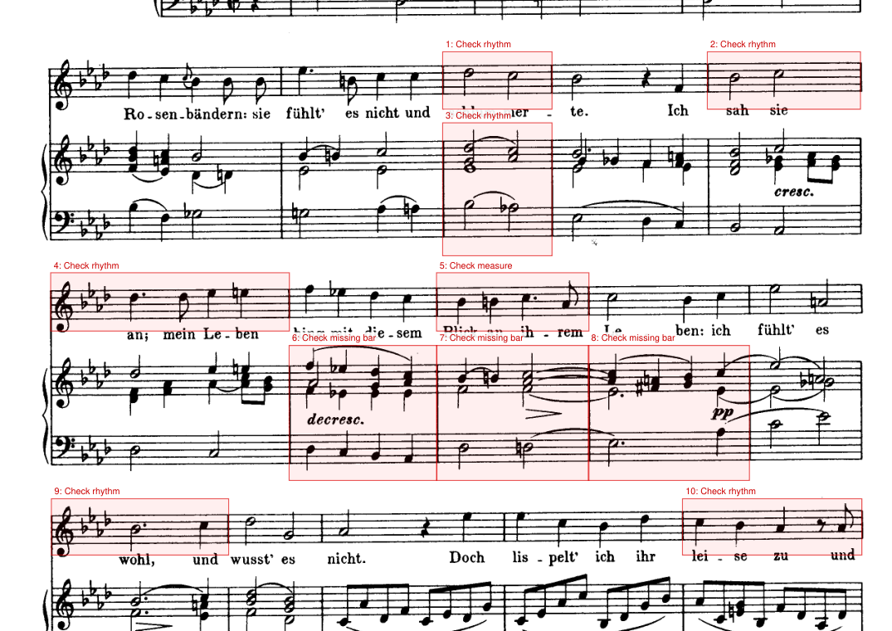

# tutti-pdf-converter

An AI agent skill that helps turn any sheet music PDF into editable MusicXML: it checks what kind of PDF it is and picks the right way to read it.

Give your AI agent (Claude Code or Codex) a sheet music PDF and ask for a file you can edit in MuseScore, Dorico, Sibelius or Finale. The agent looks at the PDF, chooses how to read it, runs what it can for you and tells you what to check afterwards. Scans and photos are read on your computer with the open-source [Audiveris](https://github.com/Audiveris/audiveris); PDFs exported from notation software are processed with [Tutti](https://tutti-studio.com/?utm_source=github&utm_medium=referral&utm_campaign=202611_github_launch&utm_content=readme), which reads the notation data inside the PDF. On the Tutti route you sign in, upload and download on its website yourself; Tutti's conversion engine is an online service and is not part of this repository.

**Don't use an AI agent?** If your PDF was exported from notation software, you can [convert it on the Tutti website](https://tutti-studio.com/?utm_source=github&utm_medium=referral&utm_campaign=202611_github_launch&utm_content=readme) directly.

## Install

Claude Code:

```
claude plugin marketplace add kanlac/tutti-pdf-converter
claude plugin install sheet-music-pdf-convert@tutti-pdf-converter
```

then start a new Claude Code session (or run `/reload-plugins` in an open one).

Codex:

```
codex plugin marketplace add kanlac/tutti-pdf-converter
codex plugin add sheet-music-pdf-convert@tutti-pdf-converter
```

then start a new Codex session.

Then just ask, for example: *"Turn score.pdf into something I can edit in MuseScore."*

## What happens

| Your PDF | What the agent does |
|---|---|
| Exported from notation software: Sibelius, or simple scores from MuseScore, Dorico and Finale ([current limits](https://tutti-studio.com/?utm_source=github&utm_medium=referral&utm_campaign=202611_github_launch&utm_content=readme)) | Recommends Tutti, which reads the notes the program drew instead of guessing from pixels. You upload it on the Tutti website after agreeing to its [privacy policy](https://tutti-studio.com/privacy). Reading it locally with Audiveris is offered as an alternative |
| A scan or photo of printed music | Installs Audiveris on your computer (asking first), adds the OCR language data it needs for lyrics and text, runs it, and gives you two things to check against the original: the MusicXML with doubtful measures marked red, and a copy of your PDF with those places boxed |
| Not sure, handwritten, damaged, or something Tutti declines | Explains what it found and what your options are; some of these end with a recommendation rather than a file |

Nothing is uploaded unless you agree. The PDF check runs offline, Audiveris runs on your computer, and only the Tutti route sends a file to a server.

After an Audiveris run you get a copy of your PDF with the doubtful places boxed, so you can check the draft against the original page (Schubert, *Das Rosenband*, scan from IMSLP):



## Mistakes the skill keeps your agent from making

We ran real scans through Audiveris and agents end to end, and wrote down what went wrong. These are the ones that look reasonable and cost the most:

- **Reading the music off the page image itself.** An agent asked to "convert" a scan may look at it and write MusicXML by hand. It invents pitches and rhythms with full confidence, which is worse than OMR and harder to catch.
- **Sending an exported PDF to OMR.** People call any PDF a "scan". If the PDF came out of notation software, OMR throws away exact data that is sitting in the file.
- **Running Audiveris without OCR language data.** It still exports notes, but every lyric, tempo word and instrument name silently disappears (same scan: 95 lyric syllables with the data, 0 without). The "fast" and "best" Tesseract models don't work here; Audiveris needs the legacy ones.
- **Feeding it a title or text page.** One page without music can make the whole run end with no export at all.
- **Believing exit code 0.** Files come out with a bar missing from one part, a staff split into extra parts, or only one surviving fragment. The skill counts measures per part before calling anything done.
- **Turning Audiveris's log into bar numbers.** `Measure{#11P2}` is an internal label, not "bar 11 of the second instrument". The skill points to the page instead of inventing a precise location.
- **Fighting a bad phone photo.** Installing image tools or uploading pages to online services rarely rescues it. The skill runs once, then gives retake advice or names tools made for photos.

## What to expect

OMR (reading music from an image) gives you a draft to correct. In our test batch of real scans (songs for voice and piano, 1–4 pages), Audiveris produced a file every time, but most needed structural fixes such as a missing bar or a staff split in two, and our synthetic phone-style photos failed to export. Clean scans of simple music work best. The red marks show where Audiveris itself noticed trouble; in our tests they caught only a minority of the measures that had wrong notes, so treat them as a starting point, not a list of every error.

Tested on macOS (Apple silicon) with Claude Code and Codex in November 2026. On Windows and Linux the agent adapts the same steps, but we have not tested them.

## For developers

`packages/identify` is the PDF identifier the skill uses: plain ES modules that run in Node and the browser, no network access. It reports the kind of PDF (vector / scan / outlined / mixed / unknown / unreadable) with per-page evidence, the notation programs it probably came from, and whether Tutti is likely to read it.

```js
import {identify} from './packages/identify/src/index.js';
import * as pdfLib from './packages/identify/vendor/pdf-lib.esm.min.js';
import rules from './packages/identify/data/identify-data.json' with {type: 'json'};

const result = await identify(pdfBytes, {pdfLib, rules});
```

Command line: `node plugins/sheet-music-pdf-convert/skills/sheet-music-pdf-convert/scripts/identify.mjs score.pdf --json`.

`packages/review` builds the offline Audiveris review helper into the same skill:

```sh
node plugins/sheet-music-pdf-convert/skills/sheet-music-pdf-convert/scripts/review.mjs score.mxl original.pdf --out-dir review
```

Node 22+ is required. The helper finds the matching `.omr` and single `.log` beside the score (or accepts `--omr` / `--log`). It writes a MusicXML copy with suspect measures in red, a PDF copy with review boxes or page notes, and a JSON summary; stdout includes the JSON and an English explanation. Existing files are never overwritten. Hints cover rhythm, unequal part measure counts and Audiveris diagnostics, including INFO messages. OMR mapping uses the exported systems and logical parts, and uncertain locations stay page-level. These hints miss errors such as pitches and accidentals; unmarked music still needs checking.

`npm test` runs the tests; `npm run build` rebuilds both single-file scripts bundled in the skill, and `npm run build:check` checks that they match the source.

## License

MIT. Audiveris is a separate program under AGPL-3.0; this repository only tells your agent where to get it and how to run it.
